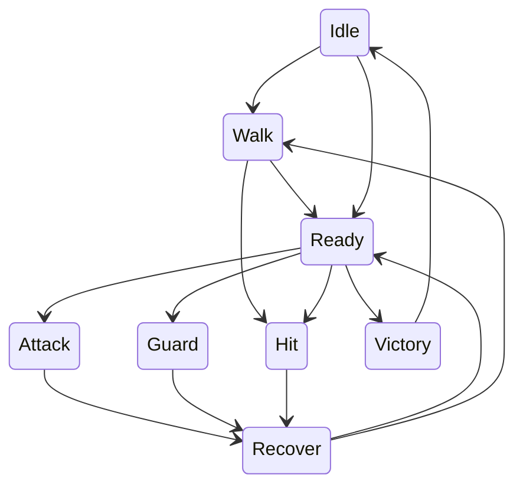

# 冒険画面・戦闘・会話の改良企画とAI実装手順

2026-11-03: [未登録敵アートの誤流用を止める（dev 404）](art/2026-11-03/ENEMY_UNMAPPED_ART_FALLBACK_REVIEW.md)。3既存IDだけを解決し、未知/nullは警告付きnull。隔離EditMode 131/137・失敗0・既知Ignored6。20種専用素材/本編遭遇/美術/実機は未完了。

2026-10-20: [歩行→攻撃を既存準備poseで3段へ（dev 401）](art/2026-10-20/HERO_WALK_ATTACK_HANDOFF_VISUAL_REVIEW.md)。接近最後0.08秒で剣25/槍32を表示、f3-4のstrikeは元の時刻/接触を維持。attempt07の実描画/実BET回帰Passed。支持足と最終美術は未承認。

2026-10-20: [接近→攻撃の隔離QA evidence index修正（dev 400）](art/2026-10-20/HERO_WALK_ATTACK_HANDOFF_VISUAL_REVIEW.md)。walk pose18=042、attack pose26=043を明示し、frame/capture CSV・実PNG変化assert・GUID隔離先を追加。attempt04の接近/攻撃/表示/実BET回帰PASS。支持足と美術は未承認。

2026-10-19: [敵HPカードを3行表示に整える（dev 399）](art/2026-10-19/COMBAT_HP_CARD_TEXT_FIT_REVIEW.md)。敵名/HP/SET・残りGを行分けし、2解像度の隔離Unity実描画/実BET回帰を通過。attempt03のJUDGE期待値fixture失敗と修正を記録。実機/最終美術/P2〜P5は継続。

2026-10-19: [戦闘帯背面のHPカード透けを修正（dev 398）](art/2026-10-19/COMBAT_HP_OPAQUE_SURFACE_REVIEW.md)。敵HPカードをalpha1にし、7状態×2解像度の隔離実描画で不透明面/帯より前の表示順をassert。全体美術/実機は未承認、P2〜P5継続。

2026-10-18: [戦闘帯を不透明な紺面へ（dev 397）](art/2026-10-18/COMBAT_BAND_OPAQUE_SURFACE_REVIEW.md)。Web版スクロールと状態色は保持し、半透明の着色面を不透明な紺/金線/細い状態アクセントに変更。attempt11の古いsurface-color assert失敗をfixtureの参照先更新で解消し、attempt12の隔離Unity実BET/7状態・計14描画/2解像度/harnessをPassed。全体美術・実機は未承認、P2〜P5継続。

2026-10-18: [戦闘ピークで下段マーキーを退避（dev 396）](art/2026-10-18/COMBAT_INTENSITY_PEAK_STRIP_REVIEW.md)。setupは上下対、攻防/Potion/Judgeピークは上段のみ。Destroyの同フレーム残像を隔離Unityで見つけて修正し、7状態/14枚とactive帯数を再検証。全画面最終美術は未承認、P2〜P5継続。

2026-10-18: [BET停止間の保持とcue順序を全sample検査（dev 395）](art/2026-10-18/HERO_ATTACK_SEQUENCE_PHASE_GUARD_REVIEW.md)。隔離Unityで剣/槍のf1/f2状態を120Hzの各sampleで確認し、anticipation/swing/contactの段階と回数を検査。槍pose32の再利用は変えず、原画判断は未承認。QA機械ゲートのみでP2〜P5継続。

2026-10-18: [通常BET攻撃の全段計測（dev 394）](art/2026-10-18/HERO_ATTACK_SEQUENCE_REVIEW.md)。剣/槍のf1→f2→f3/4を隔離Unity 120Hzで収録。槍f1/f2同poseを検出し、原画判断を残す。

2026-10-18: [歩行テンポ/攻撃切替測定](art/2026-10-18/HERO_APPROACH_WALK_CADENCE_REVIEW.md)。0.36秒接近中の原画コマ速度を修正し、120Hzでpose18→剣26/槍33への一段handoffとcontact予定時刻を確認。機械ゲートはPassed、歩行→攻撃の中割り/支持足/最終美術は未承認。P2〜P5継続。

2026-10-18: [接近中の歩行テンポ修正](art/2026-10-18/HERO_APPROACH_WALK_CADENCE_REVIEW.md)。0.36秒接近時に8コマへ圧縮していた主人公表示をJSONの0.11秒/コマに合わせた。attempt22の剣/槍連番・実BET回帰Passed。機械確認であり接近→攻撃中割り、支持足、最終美術/実機は未承認。P2〜P5継続。

2026-10-16: [戦闘帯を結果表示の前に片づける](art/2026-10-16/COMBAT_BAND_RESULT_HANDOFF_REVIEW.md)。BET中の攻防/接触/敵反応では帯を維持し、各結果routine完了後は隠し、次BETで再生成する。本番外Unity回帰Passed。結果全体の最終レイアウト/実機/音は未承認。P2/P3/P4/P5の残作業を継続し、全体完了前にpushしない。

2026-10-16: [実BETタイムライン計測](art/2026-10-16/COMBAT_TIMING_REEL_REVIEW.md)。隔離fixture 17spinの状態遷移/接触/復帰をCSV化し、summary生成と実BET回帰、126枚接近比較を確認。実入力/プレイ時間/聴感/最終美術の承認ではない。P2〜P5継続中。

2026-10-16: [剣攻撃の踏み込みを実リールで確認](art/2026-10-16/HERO_SWORD_APPROACH_REEL_REVIEW.md)。隔離実BETで剣と槍の接近を通し、両武器先端X-敵表示中心X=0px、各contact1回/recover復帰を確認。QAにsource/isolated SHA256 manifest gateを追加。これは機能ゲートで、接触絵/縦方向/最終美術の承認ではない。計画は継続中。

2026-10-16: [攻撃前の踏み込みを本編で有効化](art/2026-10-16/HERO_ATTACK_APPROACH_INTEGRATION_REVIEW.md)。本編の既存敵参照を使い、上限600px/0.36秒でcontact前に踏み込み、recoverで戻る動作を有効化。隔離Unityの限定機能検証はPassed。槍スライムの接触絵は頭上寄りで美術未承認、候補敵高さ補正は未採用。全計画完了ではない。

2026-10-14: [戦闘強弱帯の可読性調整](art/2026-10-14/COMBAT_INTENSITY_READABILITY_REVIEW.md)。14枚/7状態/2解像度を隔離Unityで再検査し、文字の過大とHP/札への重なりを縮小した。下段は主人公背面を横切り、最終美術/実機/聴感/配布ビルドは未承認。抽選/報酬/セーブ不変。

2026-10-14: [20敵ロスターの境界再検査](art/2026-10-14/ENEMY_ROSTER_REVALIDATION_REVIEW.md)で20一意ID/通常16/ボス4/既存遭遇6件と遭遇表hashを確認。planned 16、`allTwentyPlayable=false`。設計カタログ確認であり20体の制作/遭遇完了ではない。

2026-10-14: [敵3種・剣槍動作見本の隔離再描画](art/2026-10-14/ENEMY_THREE_MOTION_REFRESH_REVIEW.md)を実施。85静止画、敵288フレーム/24ポーズ/12クリップ、低FPS/割込み/決着/槍両手軸をPassed。見本再描画で、森狼preview-only、本編統合/実BET/実機/URP/配布ビルド/聴感/最終美術は未完了。

2026-10-14: [P2本編境界の再確認](art/2026-10-14/PRODUCTION_BOUNDARY_REFRESH_REVIEW.md)で読み取り専用ガード11項目を再実行。主人公接近無効、敵runtime/slime・goblin、forest_wolf preview-only、武器7系統、敵20件、既存6遭遇ID、ランタイム参照なし、`saveDataTouched=false`を確認。これは境界監査で、本編統合/全敵武器/最終美術の完了ではない。

2026-10-10: [P2本編境界再監査](art/2026-10-10/PRODUCTION_BOUNDARY_RERUN_REVIEW.md)で読み取り専用ガードを再実行。主人公接近無効、敵runtime/slime・goblin、森狼preview-only、武器7系統、20敵normal16/boss4、既存6遭遇ID、武器カタログruntime参照なし、`saveDataTouched=false`を再確認。`productionIntegrated=false`、`allTwentyPlayable=false`、`allSevenPlayable=false`、`finalArtApproved=false`。本編データ/原画/runtimeは変更なし。

2026-10-10: [EditMode隔離再検証](art/2026-10-10/EDITMODE_REFRESH_REVIEW.md)で、本番とは別の一時Unityを完走。129件中123件Passed、失敗0、既知のIgnore 6件（`result="Skipped:Ignored"`）。回帰ゲートであり、本編統合/実機/URP/配布ビルド/聴感/最終美術は未完了。セーブ/抽選/報酬/遭遇は不変。

2026-10-10: [背景ソース・光影の隔離再実描画](art/2026-10-10/BACKGROUND_REFRESH_REVIEW.md)で、本番とは別の一時Unityを再実行。30地点/3層、森12条件、時間帯4、天候9、両ゲーム解像度、屋内天候ガードをPassedし、森昼晴れ・夜雨/C-1ゲーム画面/継ぎ目を保存。これはソース/実描画の検証で、`productionIntegrated=false`、`finalArtApproved=false`、URP/実機/配布ビルド/原画承認は未完了。本編セーブ/抽選/報酬/遭遇は不変。

2026-10-10: [P2本編境界ガード](art/2026-10-10/PRODUCTION_BOUNDARY_GUARD_REVIEW.md)で、主人公接近無効、敵runtime/slime・goblin、森狼preview-only、武器7系統のexisting/planned、20敵のnormal16/boss4と既存6遭遇ID、武器カタログのC#参照なしを再照合。`productionIntegrated=false`、`allTwentyPlayable=false`、`allSevenPlayable=false`、セーブ/抽選/報酬/遭遇は不変。これは本編統合/最終美術の承認ではない。

2026-10-10: [敵3種動作見本・剣槍の隔離再実描画](art/2026-10-10/ENEMY_THREE_MOTION_REFRESH_REVIEW.md)で現行`shop-qa`を再実行。敵288フレーム/24ポーズ/12クリップ、剣/槍、低FPS/割込み/決着/槍両手軸/武器別復帰/歩行位相をPassed。森狼とスライム槍攻撃を目視したが、見本再描画であり本編統合/聴感/URP/実機/配布ビルド/最終美術は未完了。ホスト日付跨ぎの出力は`tools/hero-prototype-qa/2026-10-11/v9-enemy-motion-refresh/`。

2026-10-10: [敵・背景同場面証拠マトリクス](art/2026-10-10/SCENE_MATRIX_GUARD_REVIEW.md)で既存隔離Unity結果を読み取り専用再照合。敵3種×剣/槍126枚、敵動作85枚、C-1背景30地点/森12条件、昼晴れ/夜雨、両ゲーム解像度と1280×426背景源を確認。`productionIntegrated=false`、`finalArtApproved=false`、セーブ不変。これは原画/本編遭遇/最終美術の承認ではない。

2026-10-10: [背景・光影プローブ差分](art/2026-10-10/BACKGROUND_LIGHT_SHADOW_GUARD_REVIEW.md)でC-1/森昼晴れ/夜雨を再照合。平均RGB差56.128、30地点/森12条件/屋内天候/セーブ不変を確認したが、URP/端末/GPU/配布ビルド/最終美術は未完了。

2026-10-10: [敵3種ソース/本編境界](art/2026-10-10/ENEMY_THREE_SOURCE_GUARD_REVIEW.md)で3体×6モーションを照合。runtimeはslime/goblinのみ、森狼preview-only、全3体の専用美術は未承認。遭遇/抽選/セーブ不変。

2026-10-10: [敵3種動作見本・剣槍接続再検証](art/2026-10-10/ENEMY_THREE_MOTION_RERUN_REVIEW.md)で、現行隔離Unityの敵3種288連番/24ポーズ/12クリップ、剣/槍walk/attack/hit/victoryを確認。接触/割込み/決着/停止/低FPS/槍両手軸はPassedだが、本編遭遇/抽選/セーブ、実機/配布ビルド、聴感、最終美術は未完了。

2026-10-10: [森狼・剣槍同一identity支持足/握り](art/2026-10-10/WOLF_IDENTITY_SUPPORT_GUARD_REVIEW.md)で既存候補の重要ポーズ/支持アンカー/接地値29〜36/握り座標/剣槍カタログを検査。これは数値契約であり、identity/肩手接続、実機/URP/配布ビルド、最終美術は未完了、`mainEnabled=false`。

2026-10-10: [森狼・背景・剣槍同場面比較](art/2026-10-10/WOLF_BACKGROUND_WEAPON_REVIEW.md)で、v9の本編候補直渡し失敗を保持し、既存v1低槍候補を使うv10を隔離Unityで再実行。C-1背景上の剣/槍126枚は機械Passedだが、identity/支持足/肩手接続、URP/実機/配布ビルド、最終美術は未完了。`mainEnabled=false`。

2026-10-10: [背景30地点・光影ソースゲート](art/2026-10-10/BACKGROUND_SOURCE_GUARD_REVIEW.md)で現行Hubの隔離Unityを再実行。30地点/C-1三層、森12条件（時間4/天候9）、継ぎ目・屋内天候・セーブ不変を確認。URP/端末/GPU/配布ビルド/最終美術は未完了。

2026-10-10: [装備外見7系統の設計ゲート](art/2026-10-10/WEAPON_VISUAL_CATALOG_GUARD_REVIEW.md)で武器ID/順序と既存剣・槍のアトラス定義を固定。大槌/短剣/弓/杖/聖剣はplanned、カタログはランタイム未接続。5種の画像/動作/実機表示/最終美術は未完了、装備効果/抽選/セーブ/途中切替は不変。

2026-10-10: [20敵カタログ境界ゲート](art/2026-10-10/ENEMY_ROSTER_CATALOG_GUARD_REVIEW.md)で通常16/ボス4、既存6遭遇IDと`enemy_tables.json`の整合記録SHA256一致を再確認。これは設計/本編境界の機械ゲートであり、20体の描画・動作・遭遇・美術完了ではない。`allTwentyPlayable=false`、抽選/報酬/セーブ不変。次は同一identityの森狼素材/動作/接触を閉じる。

2026-10-10: [戦闘の強弱の帯](art/2026-10-10/COMBAT_INTENSITY_REVIEW.md)を隔離Unityで7状態・14枚検証。帯の色と文、上下一致、セーブ不変は機械Passed。本編抽選/報酬/接近/原画は不変、実機聴感・20敵・最終美術は未完了。

2026-10-10: [森狼透明復帰原画](art/2026-10-10/spear-wolf-recovery-rejected-v3-assets.json)は透明/両手軸/支持足を得たが、body-v2の髪型・画風からidentity driftのため却下。次は既存アトラス比較と戦闘強弱へ進む。

2026-10-10: [森狼復帰候補の支持足アルファ計測](art/2026-10-08/WOLF_FOOTPLANE_MEASUREMENT.md)で低い/標準戻りの透明境界を読み取り専用計測。6px差は足接地の証明ではなく、本編43ポーズ・接近無効・美術採用は保留。

2026-10-10: [森狼標準/低い復帰の同画面比較](art/2026-10-08/WOLF_RECOVERY_DUAL_REVIEW.md)を隔離検証。v7標準復帰も126描画で機械検査passed、目視では低い復帰が四足の高さ帯に連続。支持足・本編43ポーズ・接近・最終美術は未完了。

2026-10-10: [森狼歩行復帰静止画](art/2026-10-08/WOLF_RECOVERY_STILLS_REVIEW.md)をQA連番へ追加。v6の126描画で横/縦接触・足元・低FPS・取消/割込み・contact1回passed。既存候補の目視比較であり、本編43ポーズ・接近無効・支持足・最終美術は未完了。

2026-10-08: [森狼低い予備原画](art/2026-10-08/spear-wolf-prep-rejected-v2-assets.json)は低い構えを保ったが、両手槍軸とbody-v2画風が不一致のため却下。原本/プロンプト/理由を保存し、QA・本編へは未配置。

2026-10-08: [森狼低い復帰ルート](art/2026-10-08/WOLF_RECOVERY_ROUTE_REVIEW.md)をQA-onlyで比較。既存の低い戻り候補を環境変数で割り当て、v5の114描画・接触・足元・低FPS・取消/割込み・contact1回passed。原画の歩行復帰と本編接近は未採用。

2026-10-08: [森狼歩行復帰原画の編集試行](art/2026-10-08/spear-wolf-recovery-rejected-v1-assets.json)は胴体・脚を保持できず却下。原本/プロンプト/理由を保存し、v4接触候補・本編43ポーズ・接近無効は維持。次はpose33/34/35の実画像縦帯と支持足を別作りする。

2026-10-08: [森狼専用の低い槍接触原画](art/2026-10-08/WOLF_SPEAR_CONTACT_REVIEW.md)を候補化。内蔵 image_gen原本を隔離Unity v4の森狼槍接触へ接続し、114描画・横/縦接触・低FPS・取消/割込み・contact1回passed。候補のみで、本編43ポーズ・接近無効・支持足・歩行復帰・最終美術は未完了。

2026-10-08: [敵の高さ別槍姿勢](art/2026-10-08/ENEMY_HEIGHT_RULE_REVIEW.md)を隔離比較。スライム低、ゴブリン標準、森狼低接触/標準復帰と下胴/胸/中心アンカーを114描画で検証し横接触・縦接触・低FPS・contact1回passed。アンカーは候補測定で、支持足と最終美術は未完了。本編43ポーズ・接近無効を維持。

2026-10-08: [低い槍突きの前後キー](art/2026-10-08/LOW_SPEAR_TRANSITION_REVIEW.md)をQA候補へ追加。内蔵 image_gen原本2枚、姿勢比較114描画、実BET回帰3件passed。本編素材/接近は未採用、敵高さ別ルール・歩行復帰・P2〜P5は未完了。

2026-10-08: [攻防とGETの表示順](art/2026-10-07/COMBAT_REWARD_ORDER_REVIEW.md)を本編へ修正。候補3件/本編設定2件の隔離回帰passed、各58描画。新原画/接近候補は未採用、低い突きの前後姿勢とP2〜P5は未完了。

2026-10-07: [予備移動と低い槍突き](art/2026-10-07/TIMED_APPROACH_LOW_THRUST_REVIEW.md)を候補へ追加。各114描画、実BET2件passed。本編は無効、低い突きの前後姿勢とGETの重なりは未完成。

2026-10-07: [接触距離候補](art/2026-10-07/APPROACH_REVIEW.md)を剣/槍×3敵で検証。24描画と実BET2件passed。本編は無効のまま。低い敵への高さ・長距離の予備移動は未解決。全体の完成率を機械検査件数で増やさない。

2026-10-04: [槍の同体格化と中割り](art/2026-10-04/SPEAR_CYCLE_REVIEW.md)は候補44ポーズ、本編43のまま。両手接続/装備切替/実BET回帰passed、支持足と最終美術は未合格。数量追加だけでP2完成にしない。

2026-10-04: [敵台帳v2の整合](art/2026-10-04/ENEMY_ROSTER_RECONCILIATION.md)で5節の通常16＋ボス4・既存6IDと制作カタログを一致させた。遭遇表は未変更、20敵実装完了ではない。

2026-09-28続行: [敵の本編接続](ENEMY_GAMEPLAY_P2.md)へ進行。スライム/ゴブリンの2種を通常/中ボス/AT表示へ接続。森狼は見本、コウモリは旧表示。以下の「敵は見本のみ」は前段の履歴。

2026-09-28最新: [新サリアの本編接続](HERO_GAMEPLAY_P2.md)へ進行。主人公43ポーズ/20クリップと剣/槍をGameControllerへ接続した。敵は見本のみ、最終美術/聴感/OP全分岐は未完了。以下の「本編未接続」は前段の記録。

2026-09-28現在: P2は [HERO_SUPPORT_P2.md](HERO_SUPPORT_P2.md) まで進行。主人公43ポーズ/20クリップ、敵3種24ポーズ/12クリップ、リール停止と補助動作/音の見本を隔離検証。本編差し替え・最終美術・聴感は未完了。以下の数量や未実装表記は各記載日の履歴。

作成: 2026-09-23 / 実装状況の追記: 2026-09-27 / Asia/Tokyo
状態: **P1の会話・GET・呪いHUDを実装し、隔離QAを通過。P2〜P5は未完了。**

P2の2026-09-27着手記録: [HERO_PRESENTATION_P2.md](HERO_PRESENTATION_P2.md)。サリア15ポーズ、6クリップ、剣/槍、敵3体のUnity検品画面と動画を作成。本編接続・中割り・槍の両手原画は未完了。
対象: UnityProject/BigBonusBlitz / Unity 6000.3.15f1 / URP 17.3.0 / uGUI
依頼原文: [note/MEMO.md](note/MEMO.md)。継続品質: [AZURE_UI_QUALITY_STANDARD.md](AZURE_UI_QUALITY_STANDARD.md)。

### 2026-09-27 実装状況の追記

[P1の実装正本](ADVENTURE_PRESENTATION_P1.md)にコード入口、素材台帳、再制作プロンプト、失敗と修正、QA手順を記録した。顔付き会話/文字送りSE、GETの専用階層と同時表示、呪い4種HUD/説明は実装済み。2026-09-26に2解像度32枚とPlay Modeの連続シナリオが成功。実機・聴感・配布ビルド・OP保存からの全分岐再開は未検証。

以下の「今回は企画」「未実装」「次の実装担当」は2026-09-23の企画時点の記述。現在の入口は上の実装正本を優先する。次の制作対象はP2の森・3敵・2武器の完成見本。別作業の霧の森背景更新とエフェクト見本も確認し、既存成果を作り直さない。20敵・7武器・新スプライトの数量/時間/性能予算は引き続き提案で、P1の検証結果で確定したものではない。

## 1. 目指す体験

**静かな探索で世界を見せ、敵の予兆で期待を作り、攻防と決着で盛り上げ、報酬を読める余韻へ戻す。** サリアは元気で意志の強い騎士。重い剣、白い鎧、ピンクの髪、青い差し色を保ち、通常時の軽快さと危機の真剣さに差をつける。OPの消耗した表情まで笑顔に統一しない。

画面を常時光らせることを「かっこよさ」としない。主役の輪郭、攻撃の重さ、背景との距離、情報の読みやすさに制作量を配分する。リールの結果と既存の進行を理解できることが前提。演出が新しい目押し・アクション操作を要求するゲームへ勝手に変えない。

### 今回の範囲と仮置き

- 今回は企画書と履歴を作成する。実装・画像生成・抽選変更・配布は行っていない。
- 「20種類」は**既存を含む合計20種＝通常16種＋ボス4種**として企画する。既存6件のIDを残し、通常13種＋ボス1種を新設する案。20種追加の意味に変わった場合は数量表を更新する。
- 「左から右へ会話」は、横書きの文章が文字送りで現れる意味として扱う。会話窓全体を流し続ける方式にはしない。
- 以下の新しい敵名・配属・時間・フレーム数・性能予算は**提案値**。既存設定や実測結果ではない。最初のゲーム内見本を経て確定する。
- 既存の確率、報酬、物語の短縮版、セーブを尊重する。戦闘ルール追加は見た目の差し替えから独立して検証する。

## 2. 現状から分かったこと

調査日: 2026-09-23。ソースとJSONの読み取りによる確認。今回、Unityを動かして症状を再現したわけではない。

以下のコードパスは `UnityProject/BigBonusBlitz/Assets/` からの相対パス。

| 対象 | 確認した現状 | 改良の入口 |
|---|---|---|
| 敵 | `Resources/Data/enemy_tables.json` は通常3件＋ボス3件。見た目のenemyTypeはslime/goblin/batの3系統 | `Scripts/BBB.Core/EnemyEngage.cs` と敵画像のロード箇所 |
| 敵選択 | `SelectTable` はboss/variantで候補を絞って選択。ステージ別の生態分布を直接持たない | ステージ別候補・重みを別データにし、旧データのフォールバックを保持 |
| 盛り上がり | `EngageDirector.cs` に色・台詞・音の段階示唆が既にある。強弱の仕組みが全く無いわけではない | 実際の出現頻度と演出密度を計測してから増減 |
| OP会話 | `OpeningPlayer.cs` は独自Canvas（sortingOrder 900）、名前と全文表示。人物アイコンなし | 冒険の会話と共通の表示部へ |
| 冒険会話 | `GameController.cs` の `ShowLine` に文字送りあり。文字数に対して表示時間が短くなり得る | 全文表示後の待ち時間、タップ操作、音を整理 |
| GET | `GainQueueRoutine` / `GainSlide` は `_area` 配下。会話の高さを避ける処理は既にある | 高さ補正だけでなくCanvas・親・Mask・描画順を確認 |
| 主人公 | 実際に読むのは `Resources/Art/Hero/hero_*`。別のHeroGen/HeroChibiだけを直しても反映されない | ローダーと `SpriteAnimator.cs` |
| 動画再生 | `SpriteAnimator.Play` はフレームを先頭へ戻す方式。状態遷移や接続ポーズを持たない | 再生器と状態制御を分ける |
| 武器 | `Equipment.cs` にbaseId/craftId等はあるが、専用外見IDは無い。武器ベースは7系統 | baseId/craftId→外見定義の対応表 |
| 背景 | `ParallaxBackground.cs` はuGUI RawImageの重層背景。30地点×3層、時間・天候がある | ライティング対象だけを描く専用レンダラーの見本 |
| 呪い | `Curse.cs` と `game_config.json` に呪い4種＋祝福6種。maxStackは4。呪いと祝福の対を取得状態が持つ | 実際の取得状態からHUDと説明を構築 |

**診断仮説:** 見た目3系統の反復、場面ごとの演出密度の差、攻撃と音の接続不足が「波がない」印象を強めている可能性がある。原因の断定や「敵を増やせば解決」とはしない。GETの不具合も描画階層が候補だが、修正前に実際の発生経路で再現する。

### 要望と完了条件の対応

| ID | 本人の要望 | 企画の対応節 | 最低限の完了証拠 |
|---|---|---|---|
| R01 | 戦闘に強弱・波 | 4 | 同じ条件のプレイ記録、場面別の演出密度・待ち時間比較 |
| R02 | 敵20種類 | 5 | 20体の並び画像＋全20体のゲーム内遭遇・決着 |
| R03 | OP会話ビュー | 6 | 短縮版29行の全場面、スキップ・再開の検証 |
| R04 | 話者アイコン | 6 | 全話者と不明話者、表情違い、欠損時の表示 |
| R05 | GETが会話の裏になる | 7 | 会話・説明・同時獲得が重なる動画と残高検証 |
| R06 | 主人公スプライトを作り直す | 8 | 採用立ち絵との比較、実表示サイズ、全モーション動画 |
| R07 | モーションを自然につなぐ | 8 | 遷移表の全経路、割込み・ループ・低FPS確認 |
| R08 | 装備武器をゲームに反映 | 9 | 7系統の着脱・攻撃・帰還・再ロード |
| R09 | 光・影・奥行きのある背景 | 10 | 朝昼夕夜、天候、継ぎ目、端末性能の比較 |
| R10 | 会話を文字送り＋効果音 | 6 | 日本語長文・改行・全文表示・音量0の確認 |
| R11 | 呪いアイコンを常時表示 | 11 | 0個・1個・4個・同種重複・帰還後 |
| R12 | ホバーで呪い説明 | 11 | マウス・フォーカス・タッチで同じ内容を確認 |

## 3. 最初に作る「小さな完成見本」

大量の素材を先に発注せず、**C-1 霧の森の短い冒険**で最終品質と制作方式を確定する。

見本の内容:

1. サリアの待機・歩行・斬撃・被弾・復帰。剣と槍を切り替える。
2. スライム、ゴブリン、森狼の3体で「軽い相手・構える相手・素早い相手」を見分ける。
3. サリアと別話者の顔付き会話、文字送り、SE。会話中に複数のGETを発生させる。
4. 呪いを2つ付けて、効果と対になった祝福を確認する。
5. 3層背景をスクロールし、昼→夕→夜と雨を切り替える。足元影、輪郭光、霧を比較する。

**見本の合格条件:** 小さい実表示でも顔・武器・敵が区別でき、接地が滑らず、剣が曲がらず、本文と報酬が隠れず、リール操作を妨げない。同じ場面の加工前後画像と20〜40秒程度の動画を保存する。単独の大きなイラストだけで採用判断しない。

## 4. 戦闘の波を作る

### 4.1 5段階のリズム

| 段階 | 見せるもの | 音・光・動き | 抑えるもの |
|---|---|---|---|
| 探索 | 道、サリアの歩幅、小さな環境変化 | 環境音中心、柔らかい光、弱い髪揺れ | 常時振動、大きな発光、長いカットイン |
| 予兆 | 草むら・羽音・影・敵の輪郭 | 短い合図、視線や構えの変化 | 未確定なのに確定勝利に見える金色演出 |
| 攻防 | 敵の癖とサリアの反応 | ため→動作→接触→戻り。効果音を接触に合わせる | 毎回同じ画面全体フラッシュ |
| 決着 | その一撃が勝敗を決めたこと | 強い一撃にだけ短い停止感・輪郭光・強い音 | 弱攻撃と同じ大きさの演出 |
| 余韻 | 敵の退場、獲得物、次の道 | 音を減らして報酬を読ませ、自然に歩行へ戻す | 即座に次の大演出を重ねること |

この5段階は**見せ方**。抽選済みの結果を読み、勝敗を改変しない。敗北時に勝利演出を流さない。ボスは通常敵より長い構えと固有の決着を持つが、繰り返し時はテンポを保つ。

### 4.2 最初は確率を変えずに測る

記録するイベント: encounterStart/end、敵ID、地点ID、engageのターン/結果、演出種別/強度、入力を待たせた時間、報酬表示開始/終了、HP・エンバー。抽選用乱数と装飾用乱数を分け、演出をON/OFFして同じseedのゲーム結果が変わらないようにする。

比較指標: 100G当たりの遭遇数、遭遇間隔の中央値/上位値、同じ敵の連続数、強演出の連続数、静かな区間の長さ、操作できない累計時間、平均戦闘長、帰還/力尽き率、獲得量。加えて同じ短区間を見て「どこが山だったか」を人が答えられるか確認する。数値がよくても感覚の平坦さは別に評価する。

初期案は「通常戦では目立つ山を決着に1つ」「直前に強演出があれば次の弱い場面の装飾を抑える」。静かな状態を理由に当たりを増やす、負けを勝ちへ変える等はしない。遭遇分布まで変える場合は独立したバランス変更とし、JSONと比較ハーネスを更新する。

### 4.3 敵の役割は段階導入

第1段階: 同じ既存ルールでも、重い敵は長いため、軽い敵は短い踏み込み、飛行敵は高度差、硬い敵は火花、と動き・音・シルエットを変える。

第2段階の候補: 速攻型、構え型、重装型、好機型、持久型、ボス型。既存の `hero_charge` / `enemy_attack` / `hero_attack` / 判定の流れにどう接続するか定義し、属性ごとに数値をJSON化する。新ルールを入れるまでは「防御を壊すと必ず大ダメージ」など未実装効果を説明文に書かない。`EnemyEngage.DefeatPercent` と実際の討伐抽選・表示確率の正本を一致させる。

第2段階の完了には、敵ごとの役割が一言で説明できること、見た目以外にも確認可能な差があること、報酬・生存性が極端に崩れないことが必要。最終出玉調整は既存方針どおりシステムが揃ってから行う。

## 5. 敵20種類の制作台帳

名前は既存6体を除き仮称。新IDは実装前に重複確認。通常16＋ボス4の**合計20体**で、色違いだけは別種に数えない。既存ボスのgoblin/bat/slime流用も専用の体格・姿・動作へ作り直す。

| # | ID / 区分 | 名称 | 主な配属案 | 小さくても分かる姿 | 戦いの見せ方 / 将来の役割候補 |
|---|---|---|---|---|---|
| 01 | table_slime_1 / 既存通常 | スライム | A-1、B、沢沿い | 丸い水滴、低い接地 | 弾む前に沈む。基本型 |
| 02 | table_goblin_1 / 既存通常 | ゴブリン | B、C-2、D-1 | 尖った耳、粗い刃、猫背 | 大きく振りかぶり隙を見せる。構え型 |
| 03 | table_bat_1 / 既存通常 | コウモリ | D-1、D-5、E-1 | 大きな翼と小さな胴 | 羽を畳んで急降下。既存ベルチャンス特性を維持 |
| 04 | table_wolf_1 / 新通常 | 霧追いの森狼 | B-2、C-1 | 四足、長い尾、低い頭 | 地面を蹴る突進。速攻型 |
| 05 | table_moth_1 / 新通常 | 灯蛾 | C-1、D-3 | ランタン形の腹、広い羽 | 光をためて散らす。予兆が長い型 |
| 06 | table_boar_1 / 新通常 | 岩牙の猪 | B-1、C-4 | 幅広い肩、湾曲した牙 | 前脚で地を掻いて体当たり。重撃型 |
| 07 | table_vine_1 / 新通常 | 眠り蔓 | C-4、E-8 | 巻いた蔓、大きな花冠 | ほどける動きとしなる打撃。持久型候補 |
| 08 | table_beetle_1 / 新通常 | 鉄殻甲虫 | D-2、E-7 | 硬い背甲、二股の角 | 殻への火花、脚を踏ん張る。重装型 |
| 09 | table_wisp_1 / 新通常 | 迷い灯 | D-3、E-3 | 中空の火、途切れた輪郭 | 呼吸する発光、消失と再出現。幻惑表現 |
| 10 | table_miner_1 / 新通常 | 亡霊坑夫 | D-1、E-1 | 灯付き兜、つるはし | つるはしを引きずり振り上げる。構え型 |
| 11 | table_crystal_1 / 新通常 | 結晶歩兵 | E-2、E-4 | 非対称の結晶腕、細い胴 | 発光線→切り込む。好機を見せる型 |
| 12 | table_book_1 / 新通常 | 呪われた魔導書 | E-3、F-2 | 開いた本、鎖、浮遊 | ページが集まり魔法が飛ぶ。術者型 |
| 13 | table_gargoyle_1 / 新通常 | 鐘楼の石翼 | E-5、F-1 | 石の翼、鉤爪、しゃがむ姿 | 石像から動き出す重い着地。重装型 |
| 14 | table_sentinel_1 / 新通常 | 遺跡の番兵 | F-1、F-3 | 背の高い空洞鎧、長柄武器 | 規則的な構えから一撃。守衛型 |
| 15 | table_salamander_1 / 新通常 | 熾火トカゲ | E-6、G-2 | 地を這う胴、赤熱した背 | 熱をためて噴く。灼熱地域の予兆役 |
| 16 | table_bone_1 / 新通常 | 骨尾の飛竜 | G-1、G-3 | 細い翼、長い骨の尾 | 高く舞い尾で薙ぐ。終盤速攻型 |
| 17 | boss_ogre / 既存ボス | 鬼将 ガロウ | 廃坑・石切場側の関門候補 | 巨大な肩、角、大武器 | 二段のためと重い着地。大型の圧力 |
| 18 | boss_wyvern / 既存ボス | 飛竜 ヴァルガ | H-1候補。物語上の竜との対応は確認 | 広い翼、長い首、専用体形 | 飛翔→接近→大技。画面全体の大演出はここへ集中 |
| 19 | boss_slimeking / 既存ボス | 粘王 ゼラ | 沼・地下水路側の関門候補 | 王冠状の核と大きな粘体 | 収縮・膨張・崩れる決着。通常スライムとは別骨格 |
| 20 | boss_mirrorwarden / 新ボス | 鏡晶の守護者 | E-4からF方面の任意関門候補 | 浮く鏡片、左右非対称の槍 | 鏡片が集まり一撃。結晶地域の山場 |

### 分布と既存データ互換

- 地点ID→候補敵ID＋重み＋ボス候補をデータ化する。最初は第1章の30地点へ配属。全章へ同じ配置をコピーしない。
- `variant` の一致/ANY/フォールバックとboss区別を保つ。候補が空の地点、未知ID、旧セーブでゲームが止まらないようにする。
- ボスを必ず出す新ルートや討伐必須条件は、この企画だけでは追加決定しない。既存の遭遇経路を確認し、既存仕様内で候補を差し替える。
- 同種連続を抑える重み補正はゲーム性を変えるため第2段階扱い。演出だけの乱数へ紛れ込ませない。
- 20体の完成は、登録数に加えて全体が遭遇可能であること、各姿の識別、全必須アニメ、地域との整合まで確認する。

### 敵素材の共通納品

通常敵: 待機、予兆、攻撃、被弾、敗北、退場。飛行敵は高度を含めた基準点、大型は接地幅を持つ。ボスは固有予兆・固有大技・専用決着を追加する。フレーム数は体形別に決め、全20体を同じ枚数に押し込まない。

各体に `enemyId / atlas / clips / pivot / contactPoint / hitPoint / shadow / effectCue / audioCue` の定義を添付。旧type名に依存する描画分岐はデータ参照へ整理する。大きさだけ違う既存画像を「専用ボス完成」と扱わない。

## 6. OP・冒険の会話を共通化する

### 6.1 見た目

紺の不透明に近い会話面、細い金縁、左に顔のメダリオン、上辺に名前、本文は余白を確保する。アイコンの金装飾は顔を隠さず、表情を読める面積を優先。環境背景は窓の外で見せる。主画面と同じAzure書体・枠・ボタンを使う。

```text
┌─ 話者名 ─────────────────────────┐
│ [顔と表情]   文章が左から右へ現れる。          │
│              長文は自然に改行・必要なら改ページ │
└─────────────────────── 続ける ▽ ─┘
```

話している側を明るくする。人物が出ないト書きは顔枠を取り外して本文幅を戻す。「声」「？？」には別々の中立的な紋章・暗いシルエットを使う。後の正体が分かる顔、竜の輪郭、名前を先出ししない。

### 6.2 話者・表情台帳

| 対象 | 初期素材 | 演出 |
|---|---|---|
| サリア（現行speaker空文字） | 通常/笑顔/決意/驚き/疲労の5表情 | 通常冒険は元気、OP逃走は疲労。鎧・髪・白リボンを採用絵に合わせる |
| 宿の主人、灯守、店主、門番 | 各1顔を初期必須 | 年齢・輪郭・小物で区別。既存人物設定があれば優先 |
| 声、？？ | 各1匿名アイコン | 発光や縁の差だけで区別。正体を隠す |
| ト書き（speaker="*"） | 顔なし | 無駄な名前枠を出さない |
| 冒険の行商人/巡礼者/狩人/占い師/王の使者 | 5人物の顔 | 実データの話者キーと照合して接続 |

初期見積もりはサリア5＋人物9＋匿名2＝16画像。既存素材が条件を満たせば再利用する。最終数量は全StoryLineの話者キーを走査して確定する。未知の話者は名前と共通紋章で必ず読めるようにする。

`StoryLine` の既存speaker/textは維持し、speakerId / portraitId / expression / typingProfile / sfxCue等を任意指定として追加する案。表示名を翻訳しただけで顔が消えないよう、安定IDと表示名を分離。古いJSONは対応表から補う。

### 6.3 文字送り・音・入力

- `DialoguePresenter`（新設案）をOPと冒険で共用し、進行は各呼び出し元へ返す。話者切替で前の文字送り・音・コールバックが残らないようキャンセル単位を持つ。
- 全文のレイアウトを先に確定し、表示文字だけ増やす。毎文字Substringで幅が変わって改行が飛ぶ方式を避ける。日本語、結合文字、絵文字、リッチテキストのタグを途中で切らない。
- 候補速度は通常28〜36文字/秒、句読点で短い間、三点リーダで長めの間。数値は設定データへ。早送りしても音が一斉に鳴らないよう発音間隔の上限を持つ。
- SEは1文字ごとの連打を避け、短く控えめな声色を一定間隔で鳴らす。空白・句読点は原則無音。サリア/低い声/匿名で音色を変え、既存Dialogue開始音とは役割を分ける。SE音量0で完全に消えること。
- 1回目のタップ/決定キーで全文表示、全文表示後の次の入力で進む。同一フレームの入力で2行進まない。音声付き行がある場合は文字音の扱いを別指定する。
- 自動進行は「全文を出す時間」と「読み終わる待ち時間」を分ける。OPは手動を基本にし、既存スキップを維持する。冒険の短い掛け声は既存テンポに合わせる。
- 字幕100〜150%に対応し、長文はページ分割か高さ拡張。本文を縮小して帳尻を合わせない。リール・GET領域との予約位置を再計算する。
- 冒険の任意字幕OFFとOPの必須会話を区別する。OFFでOP進行が見えなくなる設計にしない。高コントラスト、文字サイズは共通設定を反映する。

### 6.4 OPは短縮版を維持

現在の `game_config.json.story.op` は8場面29行。`scenario_op.md` の長い初稿へ戻さない。2026-09-22に本人が削ったLIFE・工房・操作の細かい説明を再追加しない。逃走→消耗→暗転→宿→灯守→店→門→出発の状態保存、途中再開、スキップ時の資源・opStep/opDoneを壊さない。

## 7. GET・会話・説明を隠さない描画設計

### 7.1 原因確認の手順

1. 冒険会話、OpeningPlayer、説明モーダルそれぞれの表示中に同じ獲得イベントを出す。
2. GETと会話のCanvas、sortingOrder、overrideSorting、親子順、Mask/RectMask2D、表示Rectを記録する。
3. 高さをずらしても隠れるか確認し、単なる座標の問題と描画階層の問題を分ける。
4. 修正後は会話がGETのアニメ途中に開くケース、150%字幕、同一フレーム複数獲得でも再検証する。

### 7.2 共通の表示レイヤー

```text
奥  背景・ワールド
    戦闘キャラクター・戦闘エフェクト
    リール・常設HUD
    会話・非モーダルの説明
    GET通知（会話より手前、別の専用表示帯）
    操作を遮断するモーダルとその本文
前  現在操作しているモーダル内のツールチップ
```

`AdventureOverlayRoot` / `RewardToastPresenter` / `OverlayCoordinator` は新設候補名。Canvas番号はコード全体の既存割当を調査して一元定義する。単にGETを常に最大sortingOrderへ置くと購入確認や重要な選択まで隠すため、モーダル中は通知を保留するか、モーダルが確保した専用領域へ出す。

GETは原則会話の上方の通知帯に出す。会話の有無・大きさが変わったらCanvas座標へ変換して再配置し、祖先Maskに切られない独立ルートにする。ゲームから情報を受け取るだけにして、表示終了を報酬付与の条件にしない。再表示による二重付与を防ぐ。

同一フレームの獲得は**まとめて同時表示**する既存方針を維持する。後続グループをキューに積む。収まらない場合は代表＋「ほかN件」から内訳を確認するか、次のまとまりとして表示し、読めないサイズへ縮小しない。文字・数量・アイコンを残す。受動的な通知のGraphicは原則raycastを遮らない。

## 8. サリアのスプライトとモーション

### 8.1 絵柄と素材の作り方

採用済みの `assets/characters/salia` と `Art/UI/AzureEquip/salia-*` を人物参照にする。顔・白リボン・鎧の輪郭・配色を固定し、冒険表示に適した読みやすいアニメ調のスプライトへ簡略化する。HD-2D風という言葉だけを理由に未合意の粗いピクセル絵へ変えない。

画像生成は設定画・キーポーズ・表情の制作に使い、生成された大きなシートをそのまま完成品としない。足の位置、手、武器、髪、鎧の模様の連続性を検品し、中割りと接続姿勢を補修する。全身の左右反転で装備の左右が入れ替わる場合は専用対応が必要。

制作順: 正面/斜めの設定確認 → 冒険の基準向きと等身 → 待機と歩行 → 武器なしの基体＋手の前後差分 → 攻撃のキーポーズ → 中割り → 接続 → SE/VFXイベント。衣服や顔を毎フレーム別の解釈で生成しない。

### 8.2 シート契約（初期案）

- RGBA透過、共通キャンバス、足裏基準点を統一。透明セルのトリムで原点を変えない。武器や髪先の可動範囲まで含める。
- 256px/512pxセルの両方を実表示サイズで比較し、必要な方だけ採用。制作原本は高解像度でもよい。単純に全て最大解像度にしない。
- 各クリップへframes、各duration、loop、pivot、足の接地点、武器グリップ、前後関係、SE/VFXキュー、割込み条件を添付する。
- アトラス端に透明余白と色のにじみ対策を入れ、圧縮後の輪郭を確認。4096×2048 RGBA32はミップなしで約32MiBという上限感を持ち、使用中クリップの常駐量で測る。PNGファイルサイズだけでメモリを見積もらない。
- 命名例: `salia_body_idle_v01.png`、`salia_blade_attack_v01.png`。対応manifestに原本・生成プロンプト・参照・修正版・採用理由を記録する。ゲームの表示値や文字を画像へ焼き込まない。

### 8.3 モーション数量と接続案

以下は原画の見積もり用。fpsの固定ではなく各コマの保持時間で緩急をつける。

| クリップ | 枚数の候補 | 特に見る箇所 |
|---|---:|---|
| 待機 | 6〜8 | 胴の呼吸は小さく、目・太ももが不自然に泳がない |
| 歩行 | 8〜12 | 接地脚が滑らない、腰の上下と腕・髪が対応 |
| 抜刀/構え入り | 4〜6 | 歩行から足を止め、武器が瞬間移動しない |
| 軽攻撃 | 6〜8 | ため、振り、接触、抜け、戻りが見える |
| 強攻撃 | 8〜12 | ためと踏み込みの差。剣の長さを固定 |
| 防御 | 4〜6 | 衝撃を受けて戻る。盾や腕の接続 |
| 被弾 | 3〜5 | 一瞬の反応と復帰。永遠にのけぞらない |
| 詠唱/集中 | 各6〜8 | 手・視線と魔法の発生位置 |
| 勝利 | 8〜12 | 元気な表情、武器種に適した決め姿 |
| 消耗/倒れる | 6〜10 | OP・力尽きに必要な重さ。通常笑顔と分離 |
| 復帰・方向転換 | 各2〜4 | 他の主要姿勢へ接続する橋渡し |

これは基体と代表武器の目安。7武器分すべてを同じ原画の掛け算にはせず、共通動作と武器固有動作を分ける。



`HeroAnimationController`（状態）と再生器（フレーム表示）を分ける。同じ状態の更新ではPlayを再始動しない。回復不能の力尽きは適切な優先度で割込み、被弾は攻撃結果と順序を合わせる。主要状態に入口・出口姿勢を指定し、単純な半透明クロスフェードで二重の剣を見せない。歩行同士は足の位相を保つ。

アニメイベントは `anticipation / swing / contact / recover / footstep` 等を発火するが、ダメージや報酬の抽選元にはしない。低FPSで複数フレームを飛ばしても必要なイベントは1回、装飾SEは連打せず制限する。ポーズの再開・スキップでも二重発火しない。

髪は根元を安定、毛先に遅れと大きい振幅、リボンは別の遅れにする。剣は剛体、手と柄の接点は固定。タイトルの過去の指摘（目・太もも揺れ、髪揺れ過多、剣の歪み）を今回も検品項目として引き継ぐ。

## 9. 武器7系統を見た目へ反映

| 既存baseId | 武器 | 動き・見た目の必須差 |
|---|---|---|
| w_blade | 刃 | 基準の斬撃、刃の軌跡 |
| w_spear | 槍 | 長い柄の両手位置、突き、戻し |
| w_hammer | 大槌 | 重い持ち上げ、打ち下ろし、短い反動 |
| w_dagger | 短剣 | コンパクトな構え、速い切り返し |
| w_bow | 弓 | 弦、引き手、矢の発生と放つ姿勢 |
| w_staff | 杖 | 杖先の魔法、持ち手、詠唱動作 |
| w_holy | 聖剣 | 剣の骨格を共有しつつ専用刀身・発光・決め演出 |

推奨構成は**武器を描き込まない基体＋背面武器＋前面武器＋手/腕の前景差分＋軌跡/VFX**。コマごとの握り位置・回転・前後を定義する。剣が胴に描き込まれたまま別武器を重ねる実装は不可。

外見定義はbaseIdを基準に、工房固有品がある場合はcraftIdで上書きする。未知IDは既定外見へ戻し、アイテムの効果・所持数を失わない。既存セーブを一括変換する前に任意の外見キーとフォールバックで成立させる。

装備画面のプレビューは即座に更新。冒険は装備確定を受け取って待機/復帰境界で切り替え、実行中の攻撃は開始時の武器を最後まで使う。ゲームの効果が切り替わる時点と表示を明文化し、不一致を残さない。武器の見た目変更だけで射程や勝率を勝手に変えない。

検品: 7系統×待機/歩行/攻撃/防御/被弾/勝利、着脱、工房品、旧セーブ、未知ID、攻撃途中の変更。弓と槍を「剣画像の取り替えだけ」で完了としない。

## 10. 光・影・奥行きのある冒険背景

### 10.1 採用候補を比較する

| 方式 | 内容 | 利点 | 制限・採用方針 |
|---|---|---|---|
| A: 現uGUIの強化 | 色調、加算光、足元影、霧、粒子 | 既存背景を活かしやすい | 本当のライト応答や遮蔽とは違う。低負荷フォールバック候補 |
| B: 専用2D描画＋合成 | SpriteRendererの層とキャラを専用カメラでRenderTextureへ描画し、冒険のRawImageへ合成 | 既存HUDを保ちながら光と奥行きを作れる | 新しい描画経路と座標合わせが必要。**小さな完成見本の推奨候補** |
| C: 3Dジオラマ化 | 立体地形・カメラ・2D人物 | 床や建物の立体感を作り込める | 30地点の作り直し規模が大きい。今回の初期範囲から外す |

現行RawImageへLight2Dを置くだけで期待する陰影が完成するわけではない。Bではライト対応マテリアルを使う描画対象と、UIとして光らせない文字を分離する。UnityのLight2Dは光種別や法線マップの設定を持つため、素材・シェーダーを含めた構成で検証する。[Unity 6.3 Light2D](https://docs.unity3d.com/6000.3/Documentation/Manual/urp/2DLightProperties.html)

専用カメラの出力をRenderTextureへ描き、既存UIの表示面へ渡す構成を候補にする。描画解像度、透明部、縦横比、カメラcullingMask、二重描画、リサイズ時の解放を確認する。[Unity 6.3 Render Texture](https://docs.unity3d.com/6000.3/Documentation/Manual/class-RenderTexture.html)

### 10.2 層と光の具体像

奥から「空と遠景→霞→中景→キャラクターの地面→キャラ/敵→手前の草・枝→薄い粒子」。遠い層はコントラストを落とし、手前は局所的に濃くする。既存3層から開始し、全地点で巨大な新レイヤーを無条件追加しない。

足裏には接地影、地面の明暗には主光源方向、背面には控えめな輪郭光を使う。背景に描き込まれた太陽・影と新しい光を矛盾させない。キャラの下の楕円影は高さで大きさと濃さを変え、足が地面にいる時は落ち着かせる。

ShadowCaster2Dは2Dの遮蔽用として利用候補だが、それだけで3D床へ正確な投影影が出るとは考えない。必要な地面方向の影は別の影スプライト/メッシュ等で設計する。[Unity 6.3 2D shadows](https://docs.unity3d.com/6000.3/Documentation/Manual/urp/2DShadows.html)

| 時間・天候 | 光の方向と色 | 空気感 | 守るもの |
|---|---|---|---|
| 朝 | 淡い暖色、低い横光 | 薄い霧、柔らかい粒子 | キャラの白鎧が白飛びしない |
| 昼 | 中立の明るい主光 | 遠景の霞 | 道と敵が背景に埋もれない |
| 夕 | 暖色主光＋冷たい影 | 少ない光粒、長めの落影 | 全画面を橙一色にしない |
| 夜 | 青い環境光、灯りの暖色 | 控えめな発光、薄霧 | 表情・武器・敵の予兆は見える |
| 雨・霧 | 主光を弱める | 雨の前後差、接地の飛沫 | 文字・リールの視認性を維持 |
| 結晶・洞窟 | 地域固有の小さな発光 | 光源付近だけ粒子 | 夜と同じ青一色にしない |

霧の森C-1と結晶の間E-2で比較し、成立後に他の28地点へ展開。現在の時間経過・8天候・地点遷移を維持する。既存天候以外を追加するならデータと仕様を別途明示する。

### 10.3 継ぎ目・性能・演出設定

- [ADVENTURE_ENVIRONMENTS.md](ADVENTURE_ENVIRONMENTS.md) のシーム処理を維持する。画像だけでなく法線、発光マスク、UV、霧の切り替わりも端で跳ねないようにする。
- 既存の端照合シェーダーをSprite-Lit側で使う場合は互換実装が必要。元RawImageを外した結果、既存のつなぎ目対策を失わないよう比較する。
- 背景の画風は [PROJECT_STATE.md](PROJECT_STATE.md) と [devlog.md](devlog.md) の2026-09-14の記録を読む。過去の案内にある `BACKGROUND_ART_DIRECTION.md` は今回の作業ツリーに存在しなかった。参照素材と採用状況を再確認し、未採用案を完成素材扱いして30地点へ拡大しない。
- 初期性能目標は60fps（16.7ms）、低設定は30fps（33.3ms）候補。対象端末未確定で未実測。ライト数・影数・粒子数・RenderTextureサイズは見本のProfiler結果から決める。
- 大域光1＋局所光少数から開始し、見えない地点の光や粒子を動かさない。光・粒子・解像度に品質段階を用意する。
- ブルームや被写界深度で本文・リールをぼかさない。エフェクト控えめでは振動/強い閃光/粒子を減らす。既存の「タイトル演出を控えめに」と冒険の演出設定を混同しない。

## 11. 呪いアイコンと説明

### 11.1 現行4種を先に完成させる

| curseId | 現行名 | アイコン案 | 表示する実効果 |
|---|---|---|---|
| c_drain | 燃え急ぎ | 炎が抜けていく割れたランタン | ライフ減少の増加率 |
| c_hard | 道の険しさ | ねじれた分岐と障害 | 進行条件に加わる数 |
| c_cut | 目減り | 欠けた硬貨から落ちる粒 | 払い出し減少率 |
| c_toll | 通行料 | 閉じた門と硬貨 | 1Gに余分に消費するエンバー |

紫と黒の呪い面に象牙色のシルエット、細い金属枠。色だけで区別せず32pxでも形を識別できる構図にする。64/128pxの透過素材を用意し、数値や文字は生UI。祝福6種（目利き、魂寄せ、手練、導き、長い灯、洞窟の地図）は説明内の対比用として次に制作し、温かい金と明るい面で呪いと分ける。

### 11.2 HUDとツールチップ

常設HUDの空き帯へ「呪い」ラベル＋取得中のアイコンを配置し、会話・GET用の帯と領域を取り合わないよう一緒に設計する。現在maxStack=4。0個では帯を畳み、1〜4個では全て確認できる。アイコンの絵が32pxでも操作領域は44px以上を確保する。

同種はcurseIdでまとめ、個数バッジを付ける。ツールチップには合計効果と各取得分、**その呪いに対になった祝福**を列挙する。まとめることで祝福の情報を捨てない。将来maxStackを増やした場合は「＋N」から一覧を開ける。

```text
燃え急ぎ ×2
現在の効果: ライフ減少が合計［実値］%増加
取得内容: ［個別値］% ＋ ［個別値］%
対の祝福: 魂寄せ［実値］ / 長い灯［実値］
この冒険の間有効
```

値は `CurseState` の取得内容と実際の集計関数から作る。上限や丸めが計算側にある場合は適用後の値を表示する。パーセント、個数、エンバー/Gを混同せず、`CurseScreen` の既存文言生成を共通化して同じ意味にする。HUDだけの独自計算は作らない。

マウスは短い待ち（候補0.2秒）で表示、キーボードはフォーカス、タッチはタップで固定し外側で閉じる。画面端に収め、背面へ切れないよう専用オーバーレイで表示。ホバーだけでBETを止めず、モーダルを開いたら古いツールチップを閉じる。帰還・解除・ロード時に更新し、過去の呪いが残らないようにする。

## 12. 他AIが実装するときの作業順

下記の順序を基本とする。これは依存関係を示す企画であり、今すぐ全工程を着手・公開する指示ではない。実装を依頼された担当は、対象範囲の最新状態を確認して進める。

| 工程 | 作業・規模目安 | 主な変更先 | 完成してから次へ進む条件 |
|---|---|---|---|
| P0 | 現状の再現と計測 / 小 | 隔離QA、ログ、素材/話者一覧 | GETが隠れる経路、20体のID、描画対象、OP29行、セーブの検証用コピーが揃う |
| P1 | 情報が読める土台 / 中 | OpeningPlayer、GameController、共通会話/通知、CurseScreen/HUD | 顔・文字送り・SE、GET同時表示、呪い4種が共存。旧OP進行と入力を保持 |
| P2 | 小さな完成見本 / 大 | Hero再生器、武器定義、背景レンダラー、敵3体 | 3節の見本が動画と実描画で合格。素材契約と描画方式を確定 |
| P3 | 戦闘の波 / 中〜大 | EngageDirector、演出JSON、計測 | 演出ON/OFFで結果が同じ。強弱と余韻が伝わる。ルール変更は別差分で検証 |
| P4 | 素材と敵の展開 / 特大 | 敵テーブル/配属、20体素材、7武器、全話者 | 20種が遭遇可能、7系統で自然な全動作、全話者に表示あり |
| P5 | 地域展開と負荷調整 / 大 | 背景30地点、時間/天候、品質設定 | 継ぎ目と性能を実画面で確認。全入口・セーブ復帰・操作を総合検証 |

規模は比較用であり、日数・費用の確約ではない。P4の枚数が最大の制作負荷。P2の検証前に全武器・全敵のシートを生成すると、基準点や描画方式の変更で作り直しになる。

### 12.1 実装先と新データの候補

既存の命名・シリアライズ方式を読んでから採用する。以下は未作成の設計名であり、既存APIとして呼び出さない。

- `DialoguePresenter` / `SpeakerCatalog`: OPと冒険の表示、任意の話者ID・表情・音。
- `RewardToastPresenter` / `OverlayCoordinator`: 描画順、占有領域、同時獲得グループ。
- `HeroAnimationController` / `HeroAppearance`: 状態遷移、武器、フレームイベント。
- `AdventureWorldRenderer`: ワールド専用カメラ、RenderTexture、ライトと影、品質切替。
- `CurseHudPresenter`: 取得状態の購読、グループ化、ツールチップ。
- `speaker_catalog.json`、`hero_animation_sets.json`、`weapon_visuals.json`、`enemy_stage_pools.json`: 新設候補。数値・定義をC#へ散在させない。既存JSONに統合する場合はここへ採用結果を追記する。
- 音・演出の調整項目は既存 `tools/fx_viewer.html` / `tools/fx_sync.py` と接続する。別の調整画面を重複して作らない。

### 12.2 素材を担当するAIへの指示テンプレート

> 対象はBigBonusBlitzの［対象ID］。この企画の該当節と採用済みの参照素材を読み、既存キャラクターの顔・配色・装備を維持する。用途はゲーム中［実表示サイズ］。まず［待機/歩行/接触姿勢等］の小さい見本を作る。背景透過、足裏基準点［値］、キャンバス［値］、握り位置と前後差分は採用manifestに従う。可変の文字・数値を描かない。大きい絵だけで判定せず、実寸並び画像と連続再生を確認する。PNG原本、参照、生成プロンプト、補修内容、採用/却下理由を日付付きで保存する。

角括弧の値が未確定ならP2で測定して埋める。未確定値を既存仕様だと推測して量産しない。画像生成を実行する担当は利用可能なimagegenスキルを読み、元絵を目視してから編集する。

### 12.3 実装を担当するAIへの指示テンプレート

> AGENTS.md、CLAUDE.md、PROJECT_STATE.md、ADVENTURE_REDESIGN_PLAN_2026-09-23.md、対象の設計MDと最新コードを読む。今回の工程は［P番号・範囲］。現状との差分と完了条件を確認し、他セッションの変更を戻さない。旧セーブと表示なしのフォールバックを保持する。演出で抽選結果を変更しない。見本を実際の入口からUnityで表示して検証する。計画値・実装値・検証結果を区別してログへ残し、未完了を次のAIへ明示する。

## 13. 検証と引き継ぎの完成基準

### 実装時の検証

1. Core/Runtime/Testsのコンパイル、`docs/check_layout.py`、必要なEditMode/PlayMode検証。コミットを依頼された場合は `py -3 tools/verify/run.py` の規定チェックも実施する。
2. 抽選・敵分布・呪い計算へ変更を加えた場合は同じseedの比較、100万Gハーネス、敵候補の空集合、JSONの重複読み込み、セーブ互換を確認する。文書だけの変更にUnityテストは不要。
3. 1280×720と2556×1179の実uGUI表示、字幕100/150%、ON/OFF、音量0、長い名前・未知ID・素材欠損、OPスキップ/途中再開、タイトル/マップ/冒険からの復帰。
4. 会話中GET、複数獲得、GET途中の会話開始、説明モーダル、呪い説明、戦闘決着を重ねる。見えるだけでなくクリックとキーが正しい相手へ届くか確認する。
5. モーションは静止画だけでなく通常速度・低速・低FPSで検査。足・手・刃・リボン・目・太ももの連続性、音と接触、全遷移と割込みを確認する。
6. 20体×必要な動作、7武器×主要動作の接続を台帳で消し込む。リソースの読み込み先とゲーム内IDを照合する。
7. 30地点の朝昼夕夜、既存8天候の適用可否、スクロール境界、遷移中の光を確認する。地点の組合せは自動静止画、複雑な場面は動画。負荷は対象端末名・解像度・品質段階・CPU/GPU/メモリを添える。

### 保存する証拠

`tools/adventure-redesign-qa/<日付>/<工程-版>/` を新設する案。各版へ次を保存する。

- before/after画像、連続モーション動画、検証JSON、Console結果、Profilerの条件。
- 実行したコマンド、対象コミット/ローカル差分、使用seed、JSONの版、使用素材manifest。
- `summary.md`: 変更内容、良くなった理由、失敗と修正、未確認、次にすること。

実機、配布ビルド、聴感、ユーザープレイ評価は実施しない限り未検証。隔離環境の検証で本番のPlayerPrefsやセーブを上書きしない。

### チェックリスト（2026-09-27更新）

- [x] 現在の実装とデータを調査し、要望R01〜R12を対応付けた。
- [x] 敵20種、武器7系統、会話、呪い、背景の制作仕様と段階を文書化した。
- [x] 他AI向け手順、制作記録、完成判定を定義した。
- [x] GETの専用描画階層を実装し、隔離GameControllerで同時獲得と会話の重なりを検査する（P1）。
- [x] 共通会話、話者素材、呪いHUDを実装する（P1）。
- [x] P2の初回素材とUnity検品画面・動画を作る（制作中）。
- [ ] P2の完成見本を制作・検証する。
- [ ] 戦闘のリズム改善を計測して実装する。
- [ ] 20敵・7武器・全モーション・背景を展開する。
- [ ] 対象端末で性能・操作・聴感を確認する。

次の実装担当はP1を作り直さず、**P2見本の中割り、歩行位相、槍の両手構えを修正し、本編の分割攻撃へ接続できる状態にする**。大量の絵の生成や勝率変更から始めない。

## 14. 決定記録

| 日付 | 種別 | 内容 | 理由・検証状態 |
|---|---|---|---|
| 2026-09-23 | USER | 戦闘の波、20敵、会話、主人公、武器外見、光と影、呪い表示を企画してほしい | 原文はMEMO。実装依頼と混同しない |
| 2026-09-23 | USER | 他のAIも作業できるよう、どうすればかっこよく改善できるかまとめる | 工程・変更先・素材契約・品質判定を追加 |
| 2026-09-23 | PROPOSED | 20体は通常16＋ボス4、既存6ID維持 | 数量の仮定を明示。未実装 |
| 2026-09-23 | PROPOSED | 会話/GET/呪いの情報整理を先行 | 大きな絵ができても情報が隠れる問題は解消しないため |
| 2026-09-23 | PROPOSED | スプライトと武器を分離し、3敵・2武器・1地点で見本を作る | 手戻りの大きい量産前に接続と描画を確定するため |
| 2026-09-23 | PROPOSED | 専用2D描画をRenderTextureへ合成して照明を試す | 既存RawImage背景とLight2Dの対象の違いを吸収するため。性能未測定 |
| 2026-09-23 | VERIFIED | 企画の根拠はソース/JSON調査。OPは短縮版29行 | 新機能の動作・映像・性能を検証した意味ではない |

実装で案を変更したら、上の履歴を消さず「採用」「不採用」「置換理由」「証拠」を追記する。ゲームにまだ無い表現をnoteやお知らせで完成扱いしない。


### 2026-11-03 内蔵画像生成を再開、コウモリ8姿勢を本編接続（dev 405）

コウモリ6動作を既存遭遇へ接続し、隔離Unityの96連番・本編回帰1件/0失敗・2解像度を確認。灯蛾と5武器は生成候補まで。全20敵/7武器/背景/P2〜P5は未完了、最終美術未承認。[制作・検証記録](art/2026-11-03/BAT_RUNTIME_AND_ASSET_PRODUCTION_REVIEW.md)。

### 2026-11-05 敵20種・7武器・新背景3地点を展開（検証継続）

20敵の本編回帰22件/0失敗と206枚を確認。大槌・弓・杖の専用姿勢と飛び道具着弾待ちを実装し、7武器の単体描画238枚と取消/装備変更検査は成功。目視で大槌の握り前後とワイバーンの上端切れを修正し、本編再検証中。草原・結晶洞・竜の巣の3層素材を生成・接続。背景実描画、残り26地点、最終美術、実機、全計画完了とpushは未完了。[正本](art/2026-11-05/ROSTER_WEAPONS_ENVIRONMENT_REVIEW.md)。


### 2026-11-06 統合回帰と背景展開を継続

20敵と7武器の本編検査23件/0失敗、武器7系統の単体描画238枚を確認。隔離releaseの全EditModeは136件中135件成功・戦闘帯1件失敗。未取り込みだった既存MarqueeBand改修を関連テストと揃え、release-v2の該当1件は成功した。未知敵IDのnull返却と既存TryEnemySpritePath APIもpush先から保持。コンパイル3種/100万G/配置検査成功。

新画風の背景は既存C-1に加え、A-1/B-1/B-2/C-2/E-2/H-1の実アルファ3層を接続。H-1の端の垂直切れを原画v3で修正。追加分の時間・天候・周期・本編2解像度をnative-v3で検証中。残り23地点、敵の遠隔攻撃、支持足などは継続。機械検査の成功と最終美術・実機・配布ビルドの承認は別。共有index/本番セーブは保護。コミット/pushは隔離checkoutで準備中。

詳細: [制作・失敗・検証の正本](art/2026-11-05/ROSTER_WEAPONS_ENVIRONMENT_REVIEW.md)。
